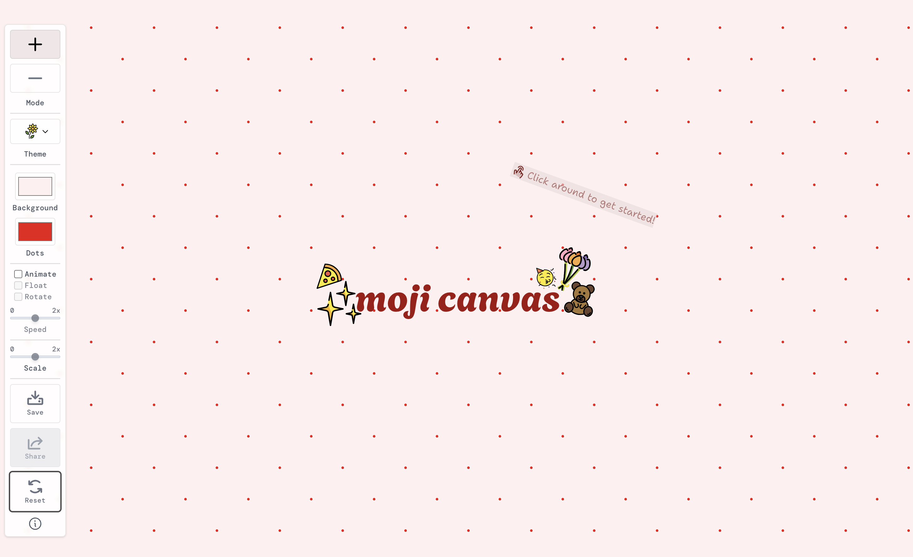

# Moji Canvas

An emoji sticker canvas where you arrange, animate and share collages made from over 4,000 OpenMoji illustrations.

**[Live site](https://moji.aniqa.dev)** · [Example canvas](https://moji.aniqa.dev/95a22e4c-9006-480c-bb15-7443b0d1a508)

<a href="https://moji.aniqa.dev"></a>

<!-- TODO: add a screenshot of the sticker editing panel (select a sticker so the size, tilt and animation controls are showing), e.g. public/editing-panel.png -->

## Tech

- React, Vite and Tailwind CSS
- Framer Motion for dragging, html-to-image for PNG export
- Supabase and React Router for shared canvases
- Radix UI, Phosphor Icons, react-focus-lock and react-share
- vite-plugin-pwa, with stickers from [OpenMoji](https://openmoji.org/)

## Features

- Drop random stickers from 10 themes, search for a specific one, or switch to remove mode and tap stickers away
- Drag stickers anywhere, then edit each one's size, tilt, animation and speed, duplicate it, bring it to the front or remove it
- 10 animations (drift, float, bounce, spin, wobble, pulse, jelly, swing, shake, orbit) with canvas-wide play, pause, shuffle and speed
- A scale slider resizes every sticker at once
- Custom background and dot colors
- Reset clears the canvas, with a second tap to confirm
- Save to your browser, download a PNG, or share a link anyone can keep editing, with one-tap copy and sharing to Bluesky, X, LinkedIn and Facebook
- Credits the designers of the stickers in use

## Design

- Animations pause above 40 stickers so dragging stays smooth, and the canvas caps out at 150
- PNG downloads leave out the toolbar and panels
- Works offline as a PWA, with every sticker cached

## Accessibility

- `Enter` adds a sticker, arrow keys nudge it (`Shift` for bigger steps), `Delete` removes it and `Escape` deselects
- Screen reader labels name each sticker and its animation
- Modals trap focus and return it on close
- Respects reduced motion

## Project structure

- `src/contexts/`: canvas state and controls (`CanvasContext`), modals and notifications (`UIContext`)
- `src/components/`: canvas, stickers, toolbar, editing panel and modals
- `src/hooks/`: keyboard shortcuts, localStorage, motion settings and sticker data loading
- `src/utils/`: sticker creation, search, animations and PNG export
- `src/data/supabase.js`: saving and loading shared canvases
- `public/stickers/`: sticker files, described in `public/data/metadata.json`

## Key concepts

- **Context API.** I moved state out of props into two contexts to learn Context properly, at the cost of one large `CanvasContext`.
- **Custom hooks** (`useKey`, `useLocalStorage`, `useAnimation`, `useMetadata`) keep components focused on rendering instead of event listeners and storage.
- **CSS keyframes for animation.** One CSS variable sets speed and `animation-play-state` pauses everything, keeping dozens of loops off the JavaScript thread.
- **Migrating saved data.** `normalizeSticker` upgrades stickers saved by older versions, so old share links still work.

## Setup

Requires Node 18+ and a free [Supabase](https://supabase.com/) project.

| Variable | Where to get it |
| --- | --- |
| `VITE_SUPABASE_URL` | Supabase → Project Settings → API |
| `VITE_SUPABASE_ANON_KEY` | Same page, the `anon` key |

Shared canvases live in a `moji_data` table. Everything but sharing works without it.

| Column | Type |
| --- | --- |
| `id` | `uuid`, primary key |
| `created_at` | `timestamptz` |
| `stickers` | `jsonb` |
| `designers` | `jsonb` |
| `backgroundColor` | `text` |
| `dotColor` | `text` |
| `scale` | `numeric` |

```bash
git clone https://github.com/aniqatc/moji-canvas.git
cd moji-canvas
npm install
# add the variables above to .env
npm start
```

## Scripts

| Command | What it does |
| --- | --- |
| `npm start` | Dev server on port 3000 |
| `npm run build` | Production build |
| `npm run preview` | Preview the build |
| `npm run lint` | ESLint |
| `npm run format` | Prettier |
| `npm run serve:mobile` | Test on a phone through ngrok |

## Changelog

### October 2026

Built with help from Claude.

- Per-sticker editing for size, tilt, animation and speed
- Animations rewritten as CSS keyframes
- Searchable sticker picker
- Older saved canvases upgrade automatically

### January 2025

- Initial release: themes, dragging, share links, PNG download and offline support
- Moved state from props into Context
